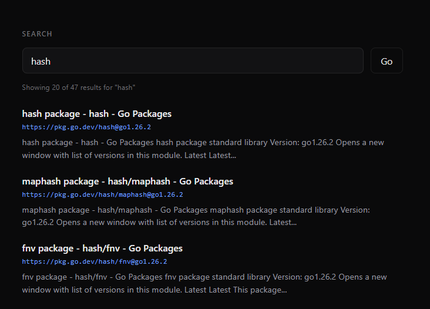

[](https://goreportcard.com/report/github.com/joyyth/search-engine-v1.0)

# Search Engine

I tried building this to learn how search engines work. I was learning Go, so I aimed it at the Go docs (pkg.go.dev/std).



---

## Architecture

```
 seed URL
    │
    │  -crawl
    ▼
┌──────────────────┐      jobs chan       ┌──────────────────┐
│   Orchestrator   │ ───────────────────▶ │   Worker Pool    │
│   BFS + dedup    │                      │   HTTP fetch,    │
│   pending count  │ ◀─────────────────── │   HTML walk,     │
│   (select loop)  │     results chan     │   link extract   │
└────────┬─────────┘                      └──────────────────┘
         │
         ▼
    data/pages.json        ◀── JSONStore (atomic tmp + rename)
         │
         │  -index
         ▼
┌──────────────────────────────────────────────────┐
│  Indexer                                          │
│    Analyzer:  lowercase → tokenize                │
│               → stopword filter                   │
│               → Snowball stem                     │
│    Postings:  term → [{docID, tf}]                │
│    TF computed at index time, stored per posting  │
└────────┬─────────────────────────────────────────┘
         │
         ▼
    data/index.json
         │
         │  -serve
         ▼
┌──────────────────────────────────────────────────┐
│  HTTP API ( :8082 )                               │
│    middleware: CORS (preflight-safe), slog log    │
│                                                   │
│    GET /          → embedded web UI (go:embed)    │
│    GET /search?q= → TF·IDF ranking + snippets     │
│    GET /stats     → doc count, top terms          │
│    GET /health    → liveness                      │
│                                                   │
│  IDF = log(1 + N/df) computed per query           │
└──────────────────────────────────────────────────┘
```

Data flows **left to right, once per mode**: crawl writes `pages.json`, index reads it and writes `index.json`, serve loads both into memory and answers queries. Each stage is a flag on the same binary (`-crawl`, `-index`, `-serve`) so you can run them in sequence or separately.

---

## Quickstart

- Clone the repository by running `git clone https://github.com/joyyth/search-engine-v1.0`
- cd search-engine-v1.0

```bash
go run ./cmd -crawl     # fetch up to 200 pages from pkg.go.dev/std → data/pages.json
go run ./cmd -index     # build the inverted index              → data/index.json
go run ./cmd -serve     # start the API + UI on http://localhost:8082
```

Then open `http://localhost:8082` in a browser, or:

```bash
curl 'http://localhost:8082/search?q=hash'
```

All three flags can be combined (`go run ./cmd -crawl -index -serve`) to run the full pipeline in one process.

---

## API

### `GET /search?q={query}`

Returns a JSON object containing the original query, elapsed search time, total matches, and up to 20 top-ranked documents with snippets centered on the highest-scoring raw-query token.

```bash
curl -s 'http://localhost:8082/search?q=goroutine' | jq .
```

```json
{
  "query": "goroutine",
  "took_ms": 1,
  "total": 20,
  "results": [
    {
      "document": {
        "id": 17,
        "url": "https://pkg.go.dev/runtime",
        "title": "runtime package - runtime - Go Packages",
        "content": "Package runtime contains operations that interact with Go's runtime system, such as functions to control goroutines..."
      },
      "snippet": "...Package runtime contains operations that interact with Go's runtime system, such as functions to control goroutines..."
    }
  ]
}
```

Errors:

| Status | Condition               |
| ------ | ----------------------- |
| 400    | `q` is missing or empty |
| 500    | JSON encoding failed    |

### `GET /stats`

Corpus-level metrics, useful for sanity-checking the index.

```bash
curl -s http://localhost:8082/stats | jq .
```

```json
{
  "total_documents": 200,
  "total_terms": 28734,
  "term_stats": [
    { "term": "wikipedia", "doc_count": 198 },
    { "term": "articl", "doc_count": 187 },
    { "term": "page", "doc_count": 176 }
  ]
}
```

`doc_count` is document frequency (df), not term count — it is the length of the posting list for that term.

### `GET /health`

```bash
curl -s http://localhost:8082/health
```

```json
{ "status": "ok" }
```

### `GET /`

Serves the embedded UI (`internal/api/web/index.html`). Reads `?q=` from the URL so results are linkable.

---

### Services and workflows

- **Crawler Workers**: Crawls pages from the seed URL with a breadth-first strategy and deduplicates visited URLs. It fetches HTML pages, extracts links, and persists crawled documents to `data/pages.json` via the JSON store.
- **Indexer**: Reads crawled pages from `data/pages.json` and builds an inverted index (`term -> postings`). It applies lowercase/tokenization/stopword filtering/stemming and writes the output to `data/index.json`.
- **TF-IDF Ranker**: Uses term frequency stored in postings and computes inverse document frequency at query time to score documents for a search query.
- **Query Engine (API)**: Serves `/search`, validates query input, runs retrieval and ranking, builds snippets. The top ranked matches are returned with snippets.
- **Stats Service**: Exposes corpus/index metrics through `/stats` so you can inspect total documents, total terms, and high document-frequency terms.
- **Client Web UI**: Serves the search interface at `/` and displays ranked results from the API.

---

## Tech stack

- Go
- HTML/CSS/JS for the client-side web interface.
- Taskfile for running the project. (not required - go run ./cmd -serve works standalone)

---

## Plans

1. **BM25 ranking behind a `?ranker=` query parameter.**
2. **BoltDB `Store` implementation.**
3. **Autocomplete (`GET /suggest?q=`).** A prefix trie built at load time over unique index terms.
